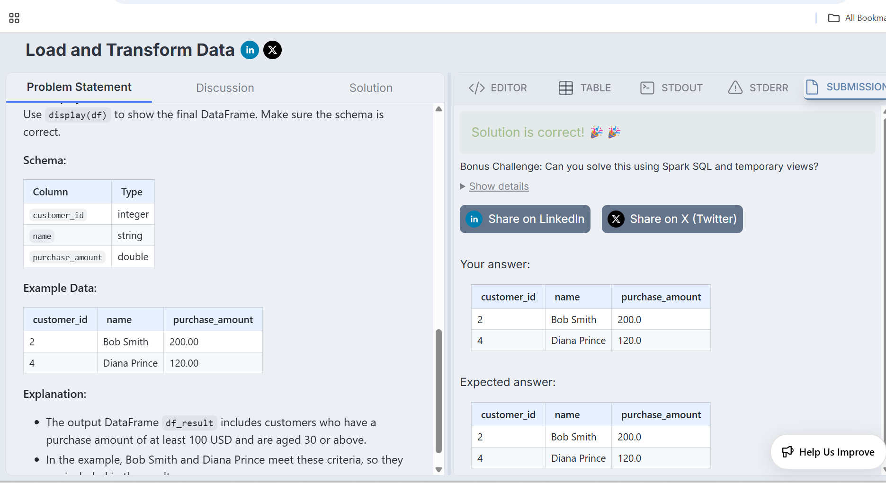

# Load and Transform Data

## Problem Statement

Read customer data from a CSV file and:

1. Infer schema automatically.
2. Filter customers with purchase_amount > 100.
3. Further filter customers with age >= 30.
4. Display the final DataFrame.

---

## Solution

```python
from pyspark.sql import SparkSession

spark = SparkSession.builder.appName("Spark Playground").getOrCreate()

df = spark.read \
    .option("header", True) \
    .option("inferSchema", True) \
    .csv("/datasets/customers.csv")

result = df.filter("purchase_amount > 100") \
           .filter("age >= 30")

display(result)
```

---

## Output



---

## Key Learning

Initially encountered:

```text
AnalysisException:
UNRESOLVED_COLUMN.WITH_SUGGESTION
```

Root Cause:

The CSV header was not loaded and Spark generated:

```text
_c0
_c1
_c2
_c3
_c4
```

instead of:

```text
customer_id
name
email
age
purchase_amount
```

Fix:

```python
.option("header", True)
```

This allowed filtering using:

```python
.filter("age >= 30")
```
